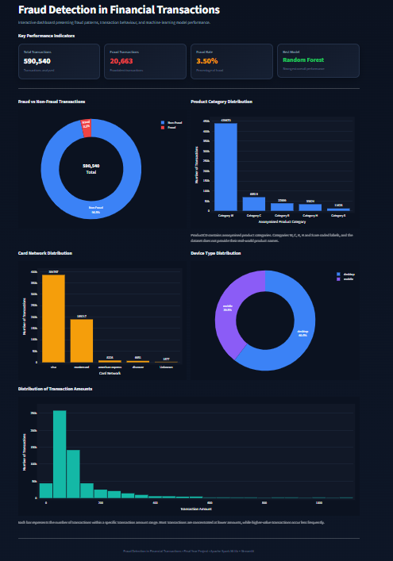
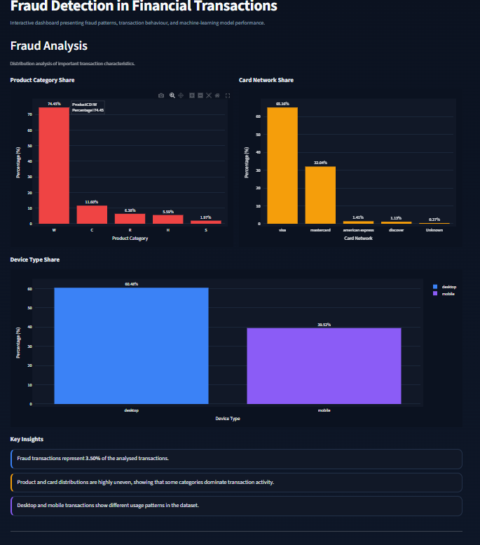
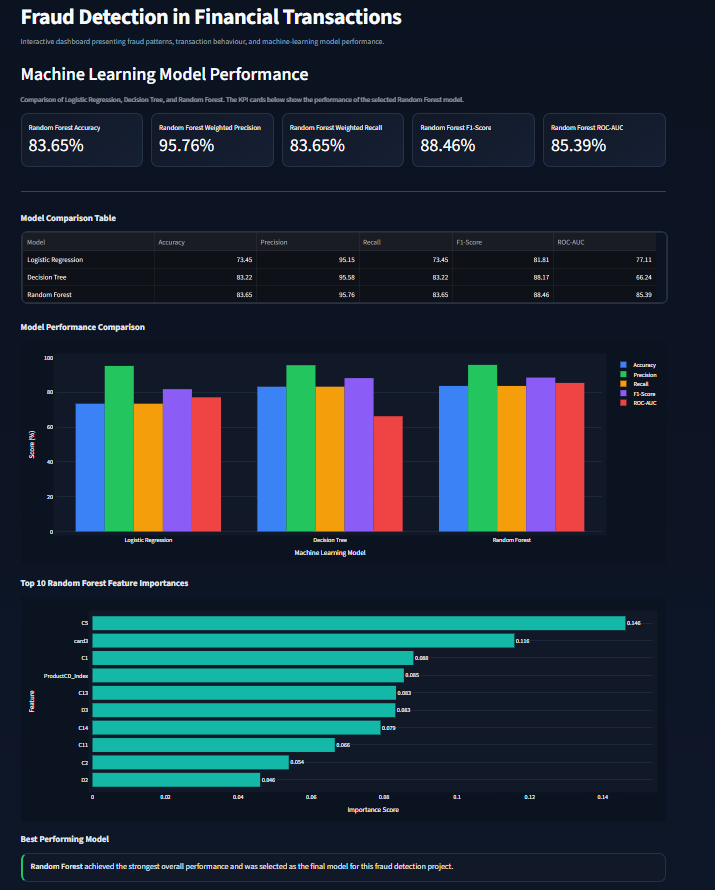

# Fraud Detection in Financial Transactions Using Apache Spark and Machine Learning

## Overview

This project was developed as part of my MSc project. It focuses on detecting fraudulent financial transactions using Apache Spark and machine learning.

The IEEE-CIS Fraud Detection dataset was used to preprocess and analyse transaction data. Three machine learning models were compared: Logistic Regression, Decision Tree and Random Forest.

Random Forest achieved the strongest overall performance. An interactive Streamlit dashboard was also developed to present the analysis and model results.

## Technologies Used

- Python
- Apache Spark
- PySpark
- Spark MLlib
- Pandas
- Streamlit
- Plotly
- Jupyter Notebook

## Machine Learning Models

- Logistic Regression
- Decision Tree
- Random Forest

## Dashboard

The Streamlit dashboard includes:

- Overview
- Fraud Analysis
- Model Performance

## Dashboard Screenshots

### Overview

### Fraud Analysis

### Model Performance
